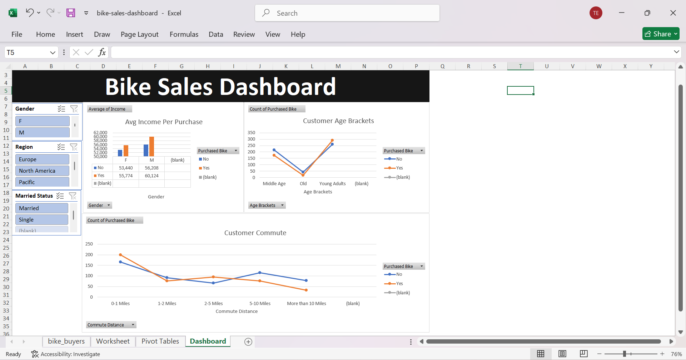

# Bike Sales Analysis Using Microsoft Excel

## Project Overview

This project involves analysing a bike sales dataset using Microsoft Excel to identify customer purchasing patterns and understand the factors influencing bike purchases.

## Project Objectives

* Analyse customer purchasing behaviour.
* Examine the relationship between income and bike purchases.
* Understand how commute distance relates to purchasing decisions.
* Analyse bike purchases across different age groups.

## Tools Used

* Microsoft Excel
* Pivot Tables
* Excel Charts
* Data Cleaning

## Data Cleaning

The following data-cleaning tasks were performed:

* Removed duplicate records.
* Standardised marital status categories.
* Standardised commute distance categories.
* Created age brackets to group customers.
* Checked the dataset for missing values.

## Data Analysis

Three major areas were analysed:

1. **Average Income Per Purchase:** Compared customers' average income based on whether they purchased a bike.
2. **Customer Commute Distance:** Examined bike purchases across different commute distances.
3. **Customer Age Brackets:** Analysed purchasing behaviour across different age groups.

## Key Findings

* 481 customers purchased bikes.
* 519 customers did not purchase bikes.
* Customer income, commute distance and age groups were explored to understand purchasing patterns.

## Dashboard Preview

## Project Files

* `bike-sales-dashboard.xlsx` – Excel workbook containing the cleaned dataset, pivot tables and dashboard.
* `dashboard-screenshot.png.png` – Dashboard preview.

---

**Project completed as part of my Data Analytics learning journey.**

